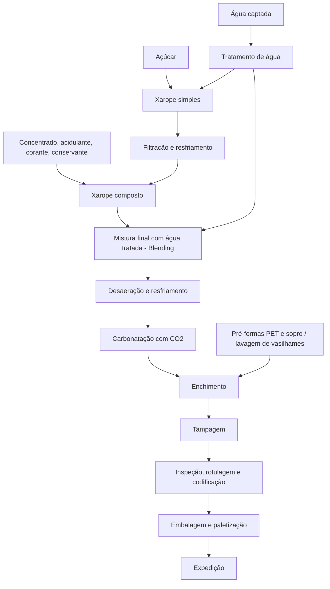
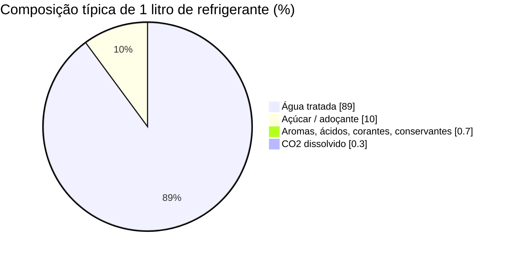
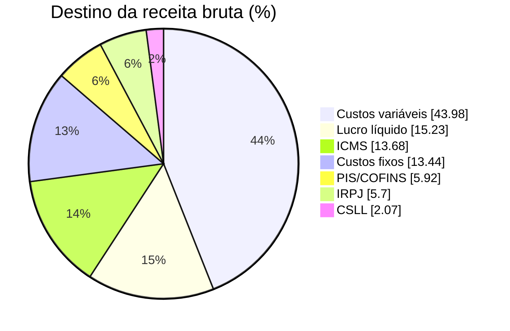
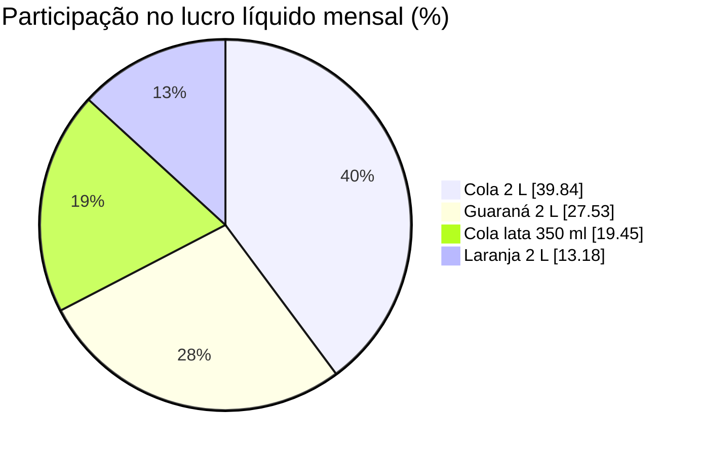
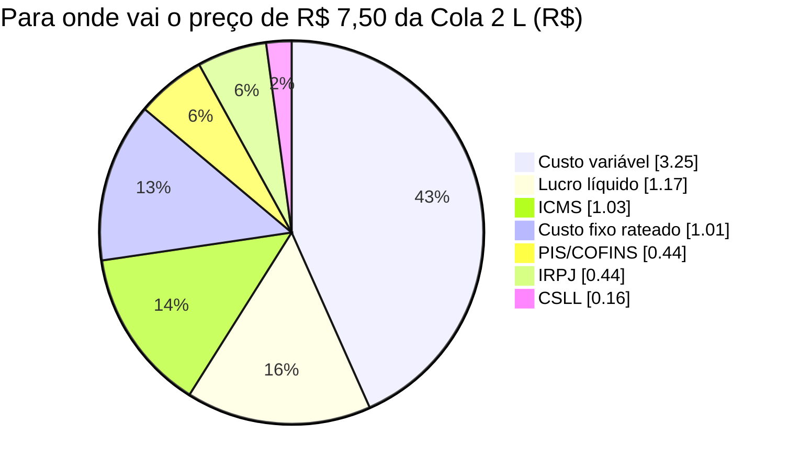
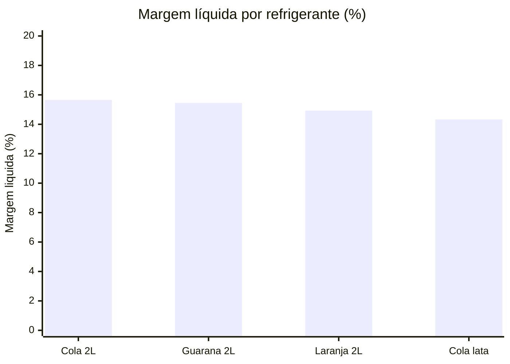

# Processo Industrial de Refrigerantes e Análise de Lucro

> Documento com (1) o processo de fabricação, (2) a projeção de lucro em **Lucro Real**, (3) o cenário **MEI** e (4) a margem de lucro por refrigerante, com gráficos.
> Os gráficos usam **Mermaid** (renderizam no GitHub, GitLab, Obsidian, VS Code com extensão, Notion etc.) e desenhos em ASCII (aparecem em qualquer editor).

---

## 1. Visão geral do processo

Um refrigerante é, basicamente, **água tratada (~88–92%) + açúcar/adoçante (~8–11%) + CO₂ + aromas, acidulantes, corantes e conservantes (< 1%)**.



---

## 2. Etapas detalhadas

### 2.1 Tratamento da água
A água é a matéria-prima principal e precisa ser **incolor, inodora e padronizada**, senão altera o sabor.

1. **Coagulação e floculação**: partículas se aglomeram.
2. **Decantação e filtração em areia**: removem sólidos.
3. **Filtro de carvão ativado**: retira cloro e odores.
4. **Abrandamento / osmose reversa**: ajusta dureza e alcalinidade.
5. **Polimento (filtro de cartucho e UV)**: garante pureza microbiológica.

```
 Água bruta ──► [Coagulação] ──► [Decantação] ──► [Filtro de areia]
                                                        │
 Água tratada ◄── [UV / Cartucho] ◄── [Osmose] ◄── [Carvão ativado]
```

### 2.2 Xarope simples
O açúcar é dissolvido em água (~55–65 °Brix), aquecido e filtrado.
Depois é **resfriado** para não degradar os aromas.

### 2.3 Xarope composto (formulação)
Ao xarope simples juntam-se o **concentrado de sabor** (segredo industrial), **acidulante** (ácido cítrico ou fosfórico), **corante** e **conservante** (benzoato de sódio, por exemplo).
Tudo é misturado em tanques de aço inox com agitação.

### 2.3.1 Proporção típica de ingredientes



### 2.4 Blending (mistura final)
Um **proporcionador** dosa, de forma contínua, o xarope composto e a água tratada (razão comum de **1 parte de xarope para 4–5 partes de água**).
O teor de açúcar é conferido em **°Brix** (colas ≈ 10–11 °Brix).

### 2.5 Desaeração e resfriamento
Retira-se o ar da bebida (evita espuma e oxidação) e ela é resfriada a **2–4 °C**, porque o CO₂ dissolve melhor no frio.

### 2.6 Carbonatação
O CO₂ grau alimentício é injetado sob pressão num carbonatador.
A medida é em **volumes de CO₂** (colas ≈ 3,5 a 4 volumes; sabores frutados ≈ 2,5 a 3).

```
          CO2 (cilindro)
              │
              ▼
   ┌───────────────────────┐
   │     CARBONATADOR      │
   │  ○ ○ ○ ○ ○ ○ ○ ○ ○   │  bolhas de CO2
   │  bebida fria (2–4 °C) │  dissolvem sob pressão
   └───────────┬───────────┘
               ▼
         para a enchedora
```

### 2.7 Enchimento, tampagem e inspeção
A enchedora rotativa (**isobarométrica**) enche a embalagem à contrapressão para não perder gás.
A tampa é aplicada logo em seguida.

```
        ┌──────────── ENCHEDORA ROTATIVA ────────────┐
        │   ▼       ▼       ▼       ▼       ▼        │
        │  [ ]     [ ]     [ ]     [ ]     [ ]       │
        └────┬──────────────────────────────┬────────┘
   garrafas  │                              │  garrafas cheias
   vazias ───┘      ►►► esteira ►►►         └──► tampadora ──► rotuladora
```

Depois: **inspeção de nível, vedação e corpos estranhos**, codificação (lote e validade) e rotulagem.

### 2.8 Embalagem final
Agrupamento em fardos (filme termoencolhível), caixas ou paletes, e expedição.

```
   🥤🥤🥤🥤🥤🥤    ┌───────────┐    ┌───────────────┐
   fardo de 6  ──►│  PALETE   │──► │  CAMINHÃO     │ ──► Distribuidor ──► Varejo
                  └───────────┘    └───────────────┘
```

### 2.9 Utilidades e qualidade (rodando em paralelo)
- **CIP (Clean-in-Place)**: limpeza automática das tubulações com soda, ácido e água quente.
- **Laboratório**: °Brix, volumes de CO₂, pH, microbiologia, sensorial.
- **Utilidades**: caldeira (vapor), compressores (ar), refrigeração (amônia ou glicol), geração de CO₂.

---

## 3. Premissas econômicas (fictícias, para simulação)

> **Importante:** os números abaixo são **hipóteses de exemplo** de uma fábrica de médio porte. Substitua pelos seus dados reais.

| Produto | Preço de venda (R$/un) | Matéria-prima e embalagem (R$/un)* | Outros custos variáveis (R$/un) | Volume (un/mês) |
|---|---:|---:|---:|---:|
| Cola 2 L | 7,50 | 2,70 | 0,55 | 200.000 |
| Guaraná 2 L | 7,00 | 2,50 | 0,55 | 150.000 |
| Laranja 2 L | 6,50 | 2,40 | 0,50 | 80.000 |
| Cola lata 350 ml | 3,20 | 1,15 | 0,30 | 250.000 |

\* Considerada a base de crédito de ICMS (12%) e PIS/COFINS (9,25%).

- **Custos fixos da fábrica**: R$ 520.000/mês (folha, energia, manutenção, depreciação, administrativo), rateados pela receita de cada produto.
- **Faturamento mensal total**: R$ 3.870.000 → **R$ 46.440.000/ano**.

### Alíquotas usadas (simplificadas)

| Tributo | Regra adotada | Base |
|---|---|---|
| ICMS | 18% de débito sobre a venda, menos 12% de crédito sobre insumos | Receita bruta |
| PIS/COFINS (não cumulativo) | 1,65% + 7,6% = 9,25% de débito, menos 9,25% de crédito sobre insumos | Receita bruta |
| IRPJ | 15% + adicional de 10% sobre o que passar de R$ 20.000/mês | Lucro antes do IR (LAIR) |
| CSLL | 9% | LAIR |

> **Avisos:** (1) bebidas têm regimes especiais (ICMS-ST, PIS/COFINS monofásico, IPI e alíquotas que variam por estado). (2) A Reforma Tributária (CBS/IBS e o Imposto Seletivo sobre bebidas açucaradas) está em transição e vai mudar esse cálculo nos próximos anos. (3) Aqui o LAIR é simplificado, sem adições e exclusões. **Valide tudo com seu contador.**

---

## 4. Lucro Real: DRE mensal projetada

| Linha | R$/mês | % da receita |
|---|---:|---:|
| (=) Receita bruta | 3.870.000,00 | 100,00% |
| (−) ICMS líquido | 529.260,00 | 13,68% |
| (−) PIS/COFINS líquido | 228.983,75 | 5,92% |
| (−) Custos variáveis (insumos, embalagem, etc.) | 1.702.000,00 | 43,98% |
| (−) Custos e despesas fixas | 520.000,00 | 13,44% |
| (=) **Lucro antes do IR/CSLL (LAIR)** | **889.756,25** | **22,99%** |
| (−) IRPJ (15% + adicional 10%) | 220.439,06 | 5,70% |
| (−) CSLL (9%) | 80.078,06 | 2,07% |
| (=) **Lucro líquido** | **589.239,13** | **15,23%** |

**Memória de cálculo (IR e CSLL):**
- IRPJ = 15% × 889.756,25 + 10% × (889.756,25 − 20.000) = 133.463,44 + 86.975,63 = **R$ 220.439,06**
- CSLL = 9% × 889.756,25 = **R$ 80.078,06**
- Lucro líquido = 889.756,25 − 220.439,06 − 80.078,06 = **R$ 589.239,13**

**Projeção anual (12 meses):**

| Item | R$/ano |
|---|---:|
| Receita bruta | 46.440.000,00 |
| ICMS + PIS/COFINS | 9.098.925,00 |
| IRPJ + CSLL | 3.606.205,50 |
| LAIR | 10.677.075,00 |
| **Lucro líquido** | **7.070.869,50** |

**Carga tributária total sobre a receita** (ICMS + PIS/COFINS + IRPJ + CSLL) = **27,36%**.

### 4.1 Para onde vai cada R$ 100 faturados



---

## 5. Cenário MEI

### Por que o MEI não serve para a fábrica
- **Limite de faturamento:** R$ 81.000/ano (≈ **R$ 6.750/mês**). A fábrica simulada fatura R$ 3,87 milhões/mês, ou seja, **mais de 570 vezes** o limite.
- **Atividade:** a fabricação industrial de bebidas não consta entre as atividades permitidas ao MEI. Ele pode **revender** refrigerantes (comércio varejista), mas não fabricar em escala industrial.
- **Funcionários:** o MEI pode ter no máximo 1 empregado, e uma fábrica precisa de dezenas ou centenas.

### Simulação: MEI revendendo refrigerante (exemplo ilustrativo)

| Item | Valor |
|---|---:|
| Preço de compra (Cola 2 L, do distribuidor) | R$ 5,20 |
| Preço de venda | R$ 7,50 |
| Faturamento no teto mensal (≈ 900 un × 7,50) | R$ 6.750,00 |
| (−) Custo das mercadorias (900 × 5,20) | R$ 4.680,00 |
| (=) Lucro bruto | R$ 2.070,00 |
| (−) DAS-MEI (INSS ≈ 5% do salário mínimo + R$ 1 ICMS)* | ≈ R$ 82,05 |
| (−) Despesas fixas (hipótese: aluguel, energia etc.) | R$ 600,00 |
| (=) **Lucro líquido** | **≈ R$ 1.387,95** |

- **Margem bruta de revenda:** 2,30 / 7,50 = **30,7%**
- **Margem líquida:** 1.387,95 / 6.750 = **20,6%**
- **Carga tributária do MEI:** 82,05 / 6.750 = **≈ 1,2%** da receita.

\* O valor do DAS-MEI muda quando o salário mínimo é reajustado. Confira o valor vigente no Portal do Empreendedor. Em revenda de bebidas, o ICMS-ST já vem embutido no preço de compra.

**Comparação rápida**

| | Lucro Real (fábrica) | MEI (revenda) |
|---|---:|---:|
| Faturamento mensal | R$ 3.870.000 | R$ 6.750 (teto) |
| Carga tributária / receita | 27,36% | ≈ 1,2% |
| Margem líquida | 15,23% | ≈ 20,6% |
| Lucro líquido mensal | R$ 589.239 | ≈ R$ 1.388 |

> A margem percentual do MEI parece maior porque ele paga pouquíssimo imposto, mas o **valor absoluto** é pequeno e o teto de faturamento impede o crescimento.

---

## 6. Margem de lucro por refrigerante (Lucro Real)

### 6.1 Fórmulas
- **Margem de contribuição (%)** = (Preço − ICMS − PIS/COFINS − Custos variáveis) ÷ Preço
- **Margem LAIR (%)** = Lucro antes do IR ÷ Preço
- **Margem líquida (%)** = Lucro líquido ÷ Preço
- Custos fixos rateados proporcionalmente à receita; IRPJ e CSLL rateados proporcionalmente ao LAIR.

### 6.2 Resultado por unidade (R$)

| Produto | Preço | ICMS | PIS/COFINS | Custo variável | Custo fixo rateado | LAIR | IRPJ | CSLL | **Lucro líquido/un** |
|---|---:|---:|---:|---:|---:|---:|---:|---:|---:|
| Cola 2 L | 7,50 | 1,03 | 0,44 | 3,25 | 1,01 | 1,77 | 0,44 | 0,16 | **1,17** |
| Guaraná 2 L | 7,00 | 0,96 | 0,42 | 3,05 | 0,94 | 1,63 | 0,41 | 0,15 | **1,08** |
| Laranja 2 L | 6,50 | 0,88 | 0,38 | 2,90 | 0,87 | 1,47 | 0,36 | 0,13 | **0,97** |
| Cola lata 350 ml | 3,20 | 0,44 | 0,19 | 1,45 | 0,43 | 0,69 | 0,17 | 0,06 | **0,46** |

### 6.3 Margens e lucro mensal

| Produto | Margem de contribuição | Margem LAIR | **Margem líquida** | Lucro líquido/mês (R$) | % do lucro total |
|---|---:|---:|---:|---:|---:|
| Cola 2 L | 37,07% | 23,63% | **15,65%** | 234.733 | 39,84% |
| Guaraná 2 L | 36,77% | 23,33% | **15,45%** | 162.236 | 27,53% |
| Laranja 2 L | 35,98% | 22,54% | **14,93%** | 77.635 | 13,18% |
| Cola lata 350 ml | 35,07% | 21,64% | **14,33%** | 114.635 | 19,45% |
| **Total** | 36,43% | 22,99% | **15,23%** | **589.239** | 100% |

**Exemplo de memória de cálculo (Cola 2 L):**
- Receita: 200.000 × 7,50 = R$ 1.500.000
- ICMS líquido: 18% × 1.500.000 − 12% × (2,70 × 200.000) = 270.000 − 64.800 = R$ 205.200 (R$ 1,026/un)
- PIS/COFINS líquido: 9,25% × 1.500.000 − 9,25% × 540.000 = 138.750 − 49.950 = R$ 88.800 (R$ 0,444/un)
- Custo variável: (2,70 + 0,55) × 200.000 = R$ 650.000
- Custo fixo rateado: 520.000 × (1.500.000 ÷ 3.870.000) = R$ 201.550
- LAIR: 1.500.000 − 205.200 − 88.800 − 650.000 − 201.550 = R$ 354.450 (R$ 1,772/un)
- IRPJ + CSLL (rateio de 300.517,13 pelo peso do LAIR) = R$ 119.717 → **Lucro líquido: R$ 234.733 → margem líquida 15,65%**

### 6.4 Gráfico de pizza: participação de cada refrigerante no lucro líquido



### 6.5 Gráfico de pizza: composição do preço da Cola 2 L (R$ 7,50)



### 6.6 Gráfico de barras: margem líquida por produto (%)



### 6.7 Leitura dos resultados
- A **Cola 2 L** tem a maior margem e também o maior volume, então responde por quase **40% do lucro**.
- A **lata de 350 ml** tem a **menor margem** (14,33%) porque a embalagem pesa mais no preço, mas contribui bastante graças ao volume.
- A **Laranja 2 L** tem margem menor e menor volume: é a candidata a reajuste de preço ou redução de custo.
- Cada **1 ponto percentual de aumento no preço médio** (≈ R$ 38.700/mês de receita) vira cerca de **R$ 18,6 mil/mês** de lucro líquido, já descontados os tributos proporcionais.

---

## 7. Resumo executivo

| Indicador | Valor |
|---|---:|
| Receita mensal | R$ 3.870.000 |
| Carga tributária total | 27,36% da receita |
| Lucro líquido mensal | R$ 589.239 |
| Margem líquida global | 15,23% |
| Melhor margem | Cola 2 L (15,65%) |
| Menor margem | Cola lata 350 ml (14,33%) |
| MEI | Inviável para fabricação (limite R$ 81 mil/ano) |

> Este material é uma **simulação educacional** com dados hipotéticos e alíquotas simplificadas. Para decisões reais, use seus custos, o regime tributário da empresa, o estado de operação e o apoio de um contador.
